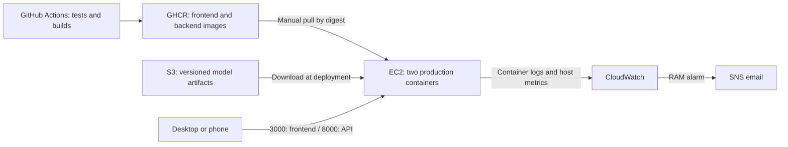

# Robust, Lightweight and Explainable Deep Learning for Tomato Leaf Disease Classification

This project combines tomato leaf classification research with a deployed web application: a responsive English-language Next.js frontend, a FastAPI CPU inference service and Grad-CAM++ explanations. The classification application runs independently of the optional Qdrant research search service.

The research compares ConvNeXt-Tiny with lightweight EfficientNet-B0 and MobileNetV3-Small students, including knowledge distillation, accuracy, robustness and inference cost.

## Current delivery status

Updated **2026-10-16**. AWS runtime status below is based on operator-provided deployment output and browser checks; it is not a fresh automated AWS audit.

| Area | Current state |
|---|---|
| Application | `GET /health`, `POST /predict` and `POST /explain`; real-model inference and Grad-CAM++ supported |
| Containers | Separate production frontend and backend images; frontend uses Next.js standalone output |
| CI | Python unit/API tests, Next.js build, backend image build, frontend container health/page/static-asset smoke tests |
| Delivery | GitHub Actions publishes both images to GHCR on successful `master` runs; tags include the full commit SHA |
| AWS deployment | Personal-account demo in **Sydney (`ap-southeast-2`)**, with two Docker containers on one EC2 instance |
| S3 artifacts | Checkpoint and class map downloaded from private prefix **`mobilenet-distilled-v1/`**; both SHA256 hashes verified against local artifacts |
| Runtime checks | EC2 backend reported healthy; `/predict` used real weights successfully; frontend page reached from desktop and phone |
| Observability | Container logs configured for CloudWatch; Agent namespace `PlantDisease/Host` and disk metric ingestion confirmed |
| Monitoring scope | CPU/RAM/disk dashboard and one RAM alarm; operating target is RAM >85%, three one-minute periods, email via SNS. Confirm saved alarm settings and email delivery in Console |

Deployment and rollback remain **manual**. GitHub Actions does not connect to EC2 or automatically restart the application. Browser prediction/Grad-CAM++ checks should be repeated after every release; page reachability alone does not validate inference.

## Deployment architecture



The three primary AWS services are **EC2, S3 and CloudWatch**. IAM provides access control, and SNS delivers alarm notifications. GHCR remains the image registry. This is a single-host HTTP demo with source-IP restrictions; HTTPS, application authentication and high availability are future work.

## Run the application

- **Existing AWS deployment:** follow [AWS operations](RUN_GUIDE.md#aws-operations-sydney) for SSH, pinned images, S3 artifacts, container lifecycle and EC2 stop/start.
- **Local Docker:** follow [local Docker Compose](RUN_GUIDE.md#local-docker-compose). The checked-in Compose configuration is for local use and has LAN-specific settings; it is not the EC2 deployment specification.
- **Local native development:** follow [native development](RUN_GUIDE.md#local-native-development) for the API launcher and Next.js dev server.
- **Validation and research:** see [tests](RUN_GUIDE.md#tests-and-validation) and [research commands](RUN_GUIDE.md#research-commands).

After a real prediction, select **Explain prediction** to compare the original image with an overlay from the same loaded checkpoint. Model identity is under **Analysis details**; explicitly labeled sample results are opt-in under **Preview options** and never enabled automatically on API failure.

## Deployed artifact reference

The operator pulled these images for source commit **`ff6b75bf3a625db124cc6449f52fa224bf76631e`**:

```text
ghcr.io/starkkk1/plant-disease-detection-api@sha256:f61be1570a834f1819614ad041f79e6114e00a0503852a121a564725cad4c27c
ghcr.io/starkkk1/plant-disease-detection-frontend@sha256:ec211d13241680f208b29f8282c7fb12a19735e9048d1f8dab9b6a27499a7f85
```

| Artifact | SHA256 |
|---|---|
| Distilled MobileNet checkpoint (`model.pth` on EC2) | `05e72798a74193499f17c4c8267c1436e8bc65cc1e8b8037245664a17644efa5` |
| Verified class map (`class_to_idx.json` on EC2) | `ff5c73e7a7e3e495593fa664b75ebc73de4c9a425f1d847351ae60bc1fbaa786` |

Expected model version: **`mobilenetv3_small_100:05e72798a741`**. The GHCR backend image contains code/dependencies and the bundled class map, but no checkpoint; AWS mounts both verified artifacts read-only. Keep the image digests, checkpoint, class map and runtime configuration together when updating or rolling back.

## Documentation

[Run guide](RUN_GUIDE.md) · [API contract](docs/api-contract.md) · [Explanation API](docs/explain.md) · [Model audit](docs/sprint-01-model-audit.md) · [Research baseline](docs/sprint-01-baseline.md)

Earlier [architecture](docs/architecture.md), [AWS readiness](docs/aws-readiness.md), [self-hosted delivery](docs/ci-cd-self-hosted.md) and Sprint 01 reports describe historical plans/checks. Their company-account prerequisites and App Runner/ECS proposals are not the current personal-account EC2 runbook. Use this README and RUN_GUIDE for current operations.

## Research Direction

The project focuses on the following pillars:

1. **Classification**: Classifying tomato leaf images into 11 disease and healthy categories.
2. **Knowledge Distillation**: Transferring knowledge from a heavy, high-performing Teacher model to lightweight Student models.
3. **Efficiency Benchmarking**: Measuring model size (MB), parameter count (M), and CPU inference latency (ms).
4. **Explainability**: Using Grad-CAM to visualize whether the models are focusing on disease-relevant leaf symptoms (e.g., mosaic patterns, bacterial spots) or irrelevant backgrounds.

## Dataset

Primary dataset: Kaggle Plant Disease Dataset (Tomato subset).

| Index | Class Name |
|---:|---|
| 0 | Tomato___Bacterial_spot |
| 1 | Tomato___Early_blight |
| 2 | Tomato___Late_blight |
| 3 | Tomato___Leaf_Mold |
| 4 | Tomato___Septoria_leaf_spot |
| 5 | Tomato___Spider_mites Two-spotted_spider_mite |
| 6 | Tomato___Target_Spot |
| 7 | Tomato___Tomato_Yellow_Leaf_Curl_Virus |
| 8 | Tomato___Tomato_mosaic_virus |
| 9 | Tomato___healthy |
| 10 | unknown |

The authoritative order is `data/new-data-removal/class_to_idx.json`, verified against the current training `ImageFolder.class_to_idx`. Checkpoints contain weights only, so retain the verified class map with every deployed artifact. See [the model audit](docs/sprint-01-model-audit.md).

## Main Models & Knowledge Distillation

| Model | Role |
|---|---|
| **ConvNeXt Tiny** | **Teacher Model**: A heavy, state-of-the-art vision model providing soft labels and feature representations. |
| **EfficientNet-B0** | **Student Model 1**: An efficient CNN balancing accuracy and computational cost. Trained both independently and via distillation. |
| **MobileNetV3-Small** | **Student Model 2**: An ultra-lightweight CNN optimized for mobile/low-resource devices. Trained both independently and via distillation. |

### Data Augmentation
Advanced augmentation techniques such as **MixUp** and **CutMix** are utilized during the distillation process to improve model robustness and generalization, ensuring the students learn effectively from the teacher.

## Project Structure & Scripts

Training, evaluation and benchmarking are available through the following scripts. They are operator-run research workflows, separate from the CI/container delivery pipeline:

1. **Training & Distillation**
   - Controlled via YAML config files in the `configs/` directory (`convnext.yaml`, `efficientnet_b0.yaml`, `distillation_mobilenetv3.yaml`, etc.).
   
2. **Evaluation (`scripts/evaluate.py`)**
   - Requires an explicit trained checkpoint and labeled dataset directory.
   - Reuses inference preprocessing and the training class map, including for subset datasets.
   - Saves **Accuracy, Macro F1, Precision, Recall**, confusion matrix counts and per-image predictions as JSON.

3. **Benchmarking (`scripts/benchmark.py`)**
   - Loads trained weights and measures checkpoint size (MiB), parameter count and p50/p95 CPU latency on real image files, including preprocessing.

4. **Explainability (`scripts/evaluate.py --gradcam`)**
   - Optional Grad-CAM++ pass with the same transform, outside classification's inference mode.
   - The original implementation remains in `src/models/inference_model.py`; the previous research evaluation workflow is preserved as `scripts/evaluate_gradcam_legacy.py`.

5. **Reproducible Sprint 01 baseline (`scripts/audit_models.py`)**
   - Verifies the current training class map, strictly loads all five checkpoints, benchmarks CPU inference and evaluates the complete `test` and external `eval` splits.
   - Saves evidence in `reports/sprint-01/`. See [the baseline report](docs/sprint-01-baseline.md) and [run commands](RUN_GUIDE.md).

## Key Findings

- **MobileNetV3-Small** checkpoints are approximately 5.97 MiB. Measured CPU latency depends on hardware, threads and image decoding; use the Sprint 01 p50/p95 baseline instead of the previous randomly initialized model benchmark.
- **Knowledge Distillation** combined with carefully tuned hyperparameters (Temperature, Alpha) can help lightweight models overcome architectural limitations.
- **Grad-CAM Analysis** reveals that models often struggle with diseases involving large-scale texture changes (e.g., *Tomato Mosaic Virus*), sometimes focusing on noisy backgrounds or misclassifying them as localized spot diseases.

## In Scope

- Tomato leaf disease image classification.
- Knowledge Distillation (Teacher-Student paradigm).
- Advanced Augmentation (MixUp, CutMix).
- Efficiency benchmarking (Latency, Parameters, Size).
- Grad-CAM explainability and misclassification analysis.
- Production frontend/backend containers and a single-EC2 AWS demo using S3 artifacts and CloudWatch monitoring.

## Out of Scope

- Bounding box annotation & Object detection (e.g., YOLO).
- Semantic segmentation.
- Full mobile application development.
