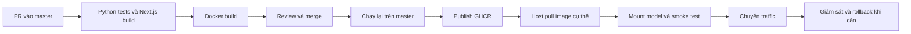

# Bài học CI/CD, deployment và monitoring qua Plant Disease Detection

Ngày kiểm tra: 2026-10-12, Asia/Bangkok. Đây là kết quả kiểm tra và bài thực hành; các cấu hình được đề xuất dưới đây chưa được triển khai.

## 1. Bằng chứng và phạm vi

- Local HEAD: `9ba846fb763a9c40c72ea84f6eb3cb6efad89114`.
- GitHub master: `270b5369aeda5bb37ed62b1b3dcbc65f7484e65b`, merge PR #14 lúc 10:38:22 ngày 12/10/2026 theo Asia/Bangkok.
- So sánh hai commit: chỉ thêm `.github/workflows/ci.yml`, `Dockerfile.deploy`, `docs/ci-cd-self-hosted.md`; code backend/tests không thay đổi.
- [PR #14](https://github.com/starkkk1/plant-disease-detection/pull/14) đã merge.
- [Run sau merge](https://github.com/starkkk1/plant-disease-detection/actions/runs/38200543045): bốn job Python tests, frontend build, image build, publish đều success.
- Log publish ghi image manifest digest `sha256:504ccc58a80b174a28f44694234b9b5525125701418ded9584d434a2a836004b`, cùng tag `latest` và full commit SHA. Đây là bằng chứng từ job publish; chưa pull lại image trên host.
- GitHub branch API trả `protected: false`; repository rulesets API trả `[]` tại thời điểm kiểm tra.
- Chạy lại local: **59 tests passed in 54.18s**.
- Native FastAPI TestClient với checkpoint `mobilenetv3_small_100_distilled_best.pth`: `/health` 200 và `/predict` 200; model version `mobilenetv3_small_100:05e72798a741`. Một request mất khoảng 81 ms trong handler, không đại diện p95, tải đồng thời hay hiệu năng container.
- Không kết nối được Docker daemon trong phiên kiểm tra này. Chưa chạy image GHCR, chưa kiểm tra frontend E2E trong phiên này, chưa thay đổi dịch vụ hoặc cấu hình GitHub.

## 2. CI, delivery và deployment khác nhau thế nào?

CI trả lời: thay đổi có vượt qua những kiểm tra đã định nghĩa không? Dự án chạy unit/API tests với fixture weights, build Next.js và build Docker trên runner Ubuntu.

Continuous delivery tạo một artifact sẵn sàng triển khai. Dự án publish backend image lên GHCR sau khi các job phụ thuộc thành công. Người vận hành vẫn chọn lúc cập nhật máy Windows.

Continuous deployment tự động đưa bản đạt yêu cầu lên môi trường phục vụ người dùng. Workflow hiện tại chưa có bước này. Frontend chỉ được build để kiểm tra, chưa được đóng gói/phát hành trong pipeline.



Các bước từ host pull trở đi là quy trình vận hành cần thực hiện; chưa tự động trong workflow. Một run xanh chỉ chứng minh phạm vi mà run đó đã kiểm tra.

## 3. Những điểm tốt và khoảng trống cần xử lý

| Nội dung | Hiện trạng | Bài học / bước tiếp theo |
|---|---|---|
| Quan hệ giữa jobs | `needs` chặn publish nếu job trước lỗi | Giữ quality gates rõ ràng |
| Quyền workflow | Mặc định `contents: read`, publish có `packages: write` | Cấp quyền theo job |
| Checkpoint | `Dockerfile.deploy` không COPY weights | Runner build được từ checkout sạch; runtime cần artifact model riêng |
| Kiểm thử ML | Fixture weights, có kiểm tra class map và load weights | Chưa chứng minh chất lượng checkpoint sản xuất; thêm smoke/evaluation thật ở bước release |
| Frontend | `npm ci`, production build | Chưa chạy Playwright trong CI; build thành công chưa bảo đảm luồng upload hoạt động |
| Bảo vệ master | Branch chưa protected, rulesets rỗng | Bắt buộc PR và ba checks Python, frontend, image build trước merge |
| Image identity | Có tag SHA và `latest` | Dùng digest để triển khai; tags có thể bị gán lại |
| Build artifact | Job verify build một image; publish build lại | Dependency/base image có thể thay đổi giữa hai build; ưu tiên build một lần, kiểm tra rồi phát hành chính artifact đó |
| Dependency reproducibility | Nhiều Python dependencies có khoảng version; base `python:3.12-slim` là tag | Lock dependency phù hợp Linux/Python 3.12, cố định base digest, cập nhật qua PR |
| Cập nhật đồng thời | Workflow chưa có concurrency control | Hai merge gần nhau có thể tranh tag latest; dùng digest và serialize bước promotion |
| Health check | 200 khi model được load, 503 khi unavailable | Gần với readiness; chưa phải thử inference định kỳ hoặc liveness độc lập |
| Logging | JSON có request ID, method, path, status, duration | Thêm model/release identity và các khoảng thời gian inference/queue riêng |
| Metrics/alerts | Chưa thấy `/metrics`, exporter hay alert rules trong mã được kiểm tra | Thiết kế metrics và kiểm thử một cảnh báo thật |
| Runbook hiện có | Có canary và hướng dẫn rollback | Canary đang chỉ kiểm `/health`; thêm `/predict`, kiểm model version; kiểm lại tên container thật và restart policy |

Required checks là cơ chế buộc tuân thủ; YAML có test không tự làm master trở thành nhánh được bảo vệ. [GitHub rulesets](https://docs.github.com/en/repositories/configuring-branches-and-merges-in-your-repository/managing-rulesets/available-rules-for-rulesets).

## 4. Release MLOps phải xác định cả model

Với backend thường, image chứa code và dependencies. Với hệ thống này, kết quả còn phụ thuộc checkpoint bên ngoài, class map, preprocessing và runtime config.

Một release record nên chứa:

```text
git_commit: full SHA
image: ghcr.io/...@sha256:manifest_digest
checkpoint_sha256: full hash of deployed weights
class_map_sha256: full hash of deployed mapping
model_name: mobilenetv3_small_100
preprocessing: resize 224 + RGB + normalization version
runtime: threads, timeouts, upload limits
validation: evaluation report + labeled dataset version
```

`model_version` hiện tại chứa model name và 12 ký tự hash checkpoint. Predictor tính cả class-map hash, nhưng chuỗi model version chưa bao gồm map/preprocessing. Lưu manifest đầy đủ để truy nguyên release.

Nếu rollback image nhưng file `.pth` đã bị ghi đè, bạn chưa khôi phục release cũ. Giữ model trong đường dẫn có phiên bản/hash, mount read-only, giữ manifest của bản trước và rollback cả bộ tương thích. Đừng thay file model tại chỗ trong khi dịch vụ đang chạy.

## 5. Bài thực hành deployment an toàn trên host

Mục tiêu: xác minh đúng image và model trước khi chuyển traffic. Đoạn lệnh sau chỉ tạo container kiểm tra trên loopback port 8001; không chuyển hoặc dừng dịch vụ chính. Chạy khi Docker Desktop đã sẵn sàng và port/tên container còn trống.

```powershell
Set-Location D:\Code\python\plant-disease-detection
$image = 'ghcr.io/starkkk1/plant-disease-detection-api@sha256:504ccc58a80b174a28f44694234b9b5525125701418ded9584d434a2a836004b'
$ckpt = (Resolve-Path '.\checkpoints\mobilenetv3_small_100_distilled_best.pth').Path
Get-FileHash -LiteralPath $ckpt -Algorithm SHA256
Get-FileHash '.\configs\class_to_idx.sprint01.json' -Algorithm SHA256
docker pull $image
docker run -d --name plant-disease-audit-270b5369 -p 127.0.0.1:8001:8000 `
  --mount "type=bind,source=$ckpt,target=/app/checkpoints/model.pth,readonly" `
  -e MODEL_NAME=mobilenetv3_small_100 $image
```

Nếu package private, xác thực bằng quyền đọc package của host trước khi pull. Đối chiếu hashes với release record; không chỉ nhìn tên file.

Sau khi model khởi tạo, thực hiện:

```powershell
Invoke-RestMethod http://127.0.0.1:8001/health
curl.exe --fail-with-body -F 'file=@frontend/tests/fixtures/tomato-leaf.jpg;type=image/jpeg' `
  -F 'top_k=3' http://127.0.0.1:8001/predict
docker inspect --format '{{json .State.Health}}' plant-disease-audit-270b5369
docker logs --tail 30 plant-disease-audit-270b5369
docker stats --no-stream plant-disease-audit-270b5369
```

Tiêu chí pass: health 200, model version đúng manifest, predict 200 với schema/lớp hợp lệ, không có lỗi load model. Ảnh fixture chưa phải gold label để kết luận accuracy. Muốn đánh giá chất lượng cần tập gán nhãn độc lập và tiêu chí ML.

Container hiện xử lý inference/explain từng lượt. Đo tải một request trước, rồi tải đồng thời nhỏ; ghi p50/p95, tỷ lệ `service_busy`, timeout, CPU/RAM. Chọn capacity dựa trên số đo. Canary container trên cổng khác chỉ là kiểm tra bản ứng viên; canary rollout thực sự còn cần chia traffic.

Sau kiểm tra, có thể dọn đúng container thử:

```powershell
docker stop plant-disease-audit-270b5369
docker rm plant-disease-audit-270b5369
```

Khi promote, xác định tên/container/port đang phục vụ thực tế trước; tài liệu cũ dùng cả `plant-disease-api-lan` và `plant-disease-api`. Nếu cần giảm downtime, đặt reverse proxy ổn định trước hai container rồi chuyển upstream sau smoke test. Nếu stop/start trực tiếp trên cùng port, chấp nhận một khoảng gián đoạn.

Đối với container chính, cân nhắc `--restart unless-stopped` và giữ container; ví dụ `--rm` hiện tại không cung cấp khả năng tự phục hồi sau reboot. Restart policy phản ứng với process exit/daemon restart; trạng thái `unhealthy` đơn thuần không tự làm Docker restart container. [Docker restart policies](https://docs.docker.com/engine/containers/start-containers-automatically/).

## 6. Monitoring: ba lớp câu hỏi

| Lớp | Câu hỏi | Tín hiệu |
|---|---|---|
| Hạ tầng | Máy/container có đủ tài nguyên? | CPU, memory, OOM, restart count, disk, host availability |
| API | Người dùng có được phục vụ đúng và nhanh? | Request rate, lỗi 5xx, 503 busy, 504 timeout, latency p95, queue wait, readiness |
| ML | Dự đoán có còn hữu ích? | Phân bố lớp, confidence, tỷ lệ unknown, ảnh không hợp lệ; macro-F1/recall khi có nhãn thật |

Log dùng để tìm chi tiết một request; metrics dùng để thấy xu hướng; trace hữu ích khi yêu cầu đi qua nhiều dịch vụ. Dự án đã có request ID để tra log nhưng chưa có distributed tracing.

Các metrics sau là **đề xuất**, chưa tồn tại trong API:

- `http_requests_total{route,method,status}`: counter; từ đó tính request rate và error rate.
- `http_request_duration_seconds`: histogram cho thời gian toàn bộ request.
- `model_inference_duration_seconds{operation}` và `model_queue_wait_seconds`: phân biệt xử lý chậm với chờ đợi.
- `model_ready`: gauge 0/1; `model_inflight`: gauge số lượt đang thực thi.
- `prediction_total{class_id}` và histogram confidence: theo dõi phân bố đầu ra.

Theo dõi `/predict` và `/explain` riêng: Grad-CAM dùng cùng slot, có thể khiến prediction thường chờ hoặc nhận 503. Backend giữ slot của native call sau khi trả 504 đến khi worker hoàn tất; timeout HTTP không có nghĩa CPU đã dừng làm việc.

Dùng route template/nhóm route cố định cho labels. Request ID, filename, đường dẫn tùy ý và nội dung ảnh có số giá trị quá lớn; đặt chúng trong log phù hợp thay vì labels metrics. Histogram giúp tổng hợp latency; tránh lấy trung bình p95 của từng instance. [Prometheus instrumentation](https://prometheus.io/docs/practices/instrumentation/), [histograms](https://prometheus.io/docs/practices/histograms/).

Ngưỡng thực hành ban đầu có thể là predict p95 dưới 1 giây và tỷ lệ 5xx dưới 1% trong một cửa sổ đủ traffic. Đây là mục tiêu thử nghiệm, chưa là SLO đã xác nhận. Cần dựa trên tải và trải nghiệm mong muốn; tách expected invalid-upload 4xx khỏi service failures.

Mỗi alert phải gắn hành động: readiness mất thì xem lỗi mount/load; 503 busy tăng thì xem queue/CPU/Grad-CAM; 504 tăng thì kiểm tra inference và native call còn chạy; OOM thì kiểm tra kích thước ảnh, số workers và memory limit. Tránh restart mù quáng khi nguyên nhân là model thiếu.

Data drift là thay đổi phân bố ảnh đầu vào; prediction drift là thay đổi phân bố đầu ra; concept drift là thay đổi quan hệ đầu vào với nhãn. Không thể kết luận accuracy giảm chỉ từ confidence hoặc không có nhãn thật. Dùng các tín hiệu này để yêu cầu lấy mẫu/gán nhãn và đánh giá lại; không tự retrain/promote chỉ vì confidence giảm.

## 7. Lộ trình và bài kiểm tra hiểu bài

1. Bảo vệ master: PR bắt buộc, ba checks bắt buộc; thử một PR có test lỗi và xác nhận merge bị chặn.
2. Tạo release manifest, chạy image theo digest với checkpoint thật; lưu health/predict evidence.
3. Kiểm thử rollback bằng một cặp image/model đã biết tốt, đo thời gian phục hồi.
4. Thêm metrics/dashboard cho health, request rate, error rate, p95, CPU/RAM; tạo lỗi có kiểm soát trong môi trường thử để xác nhận alert.
5. Thêm labeled evaluation gate cho model release: macro-F1, recall từng lớp, latency và RAM; không chọn ngưỡng tùy ý sau khi đã nhìn kết quả.
6. Sau khi vận hành ổn định mới tự động hóa promotion/deployment. Nếu chuyển AWS, có thể dùng OIDC cho credentials tạm thời và ràng buộc repo/branch/environment trong trust policy. [GitHub OIDC with AWS](https://docs.github.com/en/actions/how-tos/secure-your-work/security-harden-deployments/oidc-in-aws).

Câu hỏi tự kiểm tra:

- Vì sao build Docker xanh nhưng `/health` vẫn có thể 503? Vì image không có weights hoặc mount/config/model load lỗi.
- Vì sao 59 tests xanh chưa đủ kết luận model tốt? Tests dùng fixture; chất lượng cần checkpoint thật và dữ liệu gán nhãn độc lập.
- Vì sao tag SHA chưa mạnh bằng digest? Tag là tên có thể gán lại; digest xác định nội dung artifact.
- Vì sao `/health` 200 nhưng người dùng vẫn thấy 503? Model loaded nhưng slot inference có thể bận.
- Vì sao rollback code chưa đủ? Model/map/preprocessing/config cũng quyết định hành vi.
- Vì sao API latency tốt chưa đủ cho ML monitoring? Model có thể trả lời nhanh nhưng sai trên ảnh thực địa.
